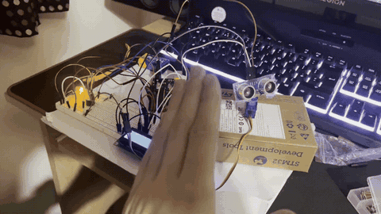
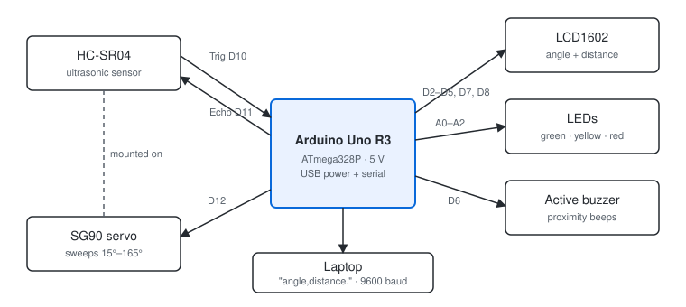
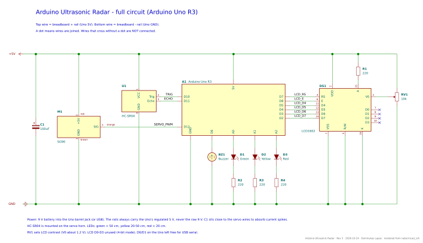
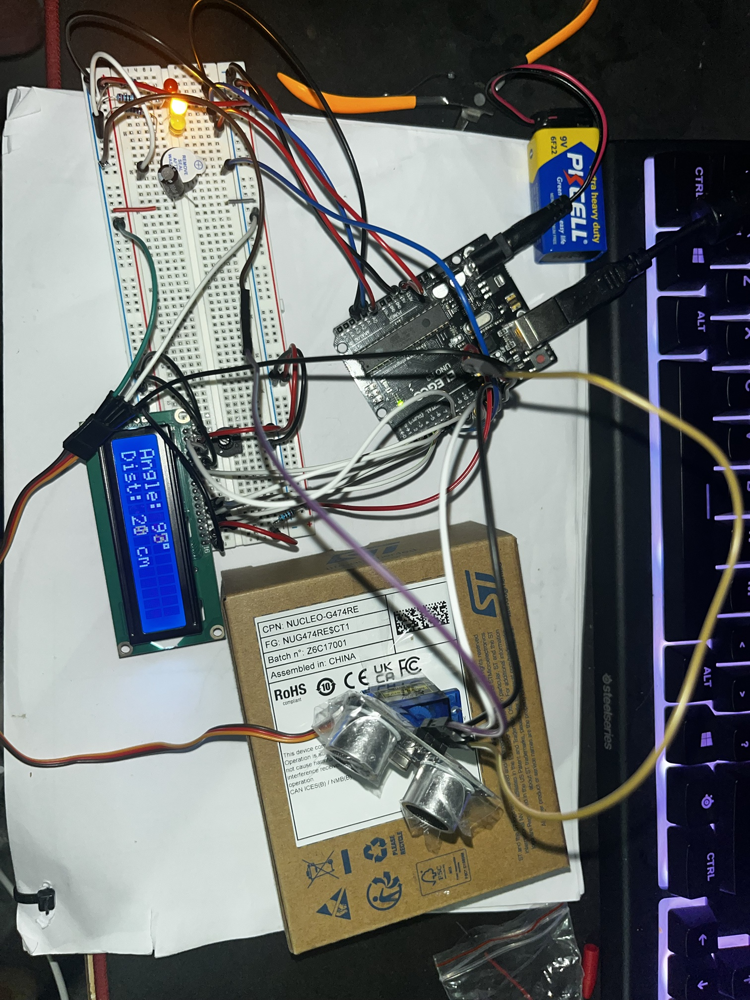

# Arduino ultrasonic radar

A sweeping ultrasonic "radar" built on an Arduino Uno R3. An HC-SR04 sensor mounted on an
SG90 servo scans from 15° to 165° and back, measuring the distance to the nearest object at
every degree. The angle and distance are shown on an LCD1602, red/yellow/green LEDs and a
buzzer warn as objects get closer, and every reading is streamed over serial so a laptop can
draw a live radar screen. I planned the pins, worked out the timing and resistor values by
hand, and built and tested it in stages.

*The finished radar: as my hand moves towards and away from the sensor, the warning LEDs
and the LCD reading change.*

The repo has two halves:

- **[`final`](final/)** — the finished product: firmware, KiCad schematic, wiring tables,
  design calculations and test data.
- **[`journey`](journey/)** — how I got there: the engineering log, photos in build order,
  every problem I hit and how I fixed it, and my progress learning C.

<!-- TODO: replace with the real block diagram once you're happy with it -->
## Block diagram

## Full circuit

The top wire is the breadboard + rail (Uno 5V) and the bottom wire is the − rail (Uno GND);
a dot means wires are joined. Drawn in KiCad, with every connection checked against the
wiring plan. You can open it without KiCad as
[SVG](final/hardware/images/schematic.svg), [PNG](final/hardware/images/schematic.png) or
[PDF](final/hardware/images/schematic.pdf); the editable project is in
[final/hardware/kicad/](final/hardware/kicad/) and the pin-by-pin wiring tables are in
[final/hardware/README.md](final/hardware/README.md).

## Results

<!-- TODO: fill with YOUR measurements. Put the raw numbers in final/test-data/. -->

| | |
|---|---|
| Distance accuracy | 92.23% (calculated from 5 readings using a ruler) |
| Usable range | 2 cm to ~60 cm (beyond that, reading states 'clear') |
| Sweep time | 3.93 s (calculated average from 3 readings using a stopwatch) |
| Angular resolution | 1° steps |
| Warning zones | red < 20 cm, yellow 20–50 cm, green 50+ cm |
| LCD contrast voltage | V0 = 1.278 V measured vs ≈ 1.2 V from the datasheet (about 2 % off the recommended VDD − V0) |

*The finished build: Uno R3 on a 9 V battery, LCD showing angle and distance, warning LEDs
and buzzer on the breadboard, and the HC-SR04 taped to the SG90 servo.*

## How it works

1. The servo moves the sensor one degree at a time between 15° and 165°, pausing 30 ms at
   each angle so it settles. The end stops are avoided because the SG90 strains and jitters there.
2. At each angle the Uno sends a 10 µs pulse on the HC-SR04's Trig pin. The sensor fires a
   40 kHz burst and holds its Echo pin high until the echo returns.
3. `pulseIn()` measures how long Echo stays high. That is the sound's round trip.
4. The distance picks the warning zone. The LEDs follow it directly, and the buzzer beeps
   using `millis()` (75 ms on every 500 ms for yellow, every 150 ms for red), so the beeping
   never pauses the sweep the way `delay()` would.
5. The LCD shows the angle and distance, and the reading is sent over serial as
   `angle,distance.` for the laptop display.

## How I built it

| Stage | What I did | Where |
|---|---|---|
| Design | Pin planning, resistor values, timing and range calculations, KiCad schematics | [design calculations](final/docs/design-calculations.md), [schematic](final/hardware/kicad/) |
| LCD (done) | Power rails, contrast pot set and measured, HelloWorld wiring test | [journey](journey/README.md) |
| 1. Sensor | HC-SR04 alone, readings checked on Serial Monitor against a tape measure | [hardware](final/hardware/README.md) |
| 2. Servo | Added the sweep; checked for jitter and resets on USB power | [hardware](final/hardware/README.md) |
| 3. Warnings | LEDs and buzzer, non-blocking beep timing | [firmware](final/firmware/README.md) |

The full story with photos is in [journey](journey/README.md), and the day-by-day record is
in the [engineering log](journey/engineering-log.md).

## Parts

| Part | Notes |
|---|---|
| Microcontroller | Arduino Uno R3 (ATmega328P, 5 V) |
| Distance sensor | HC-SR04 ultrasonic, ~2 cm–4 m rated, ~15° beam |
| Servo | SG90 micro servo |
| Display | LCD1602 (HD44780-compatible, parallel), 10 kΩ contrast pot |
| Indicators | Red, yellow, green LEDs, 3 × 220 Ω |
| Buzzer | Active buzzer |
| Decoupling | 100 µF electrolytic across the servo supply |
| Power | USB from laptop; 9 V battery into the barrel jack while wiring |

Datasheets for each part, with the specs this design relies on, are in
[final/docs/datasheets/](final/docs/datasheets/README.md).

Measuring equipment: Crenova MS8233D digital multimeter. <!-- TODO: add tape measure etc. as used -->

## Problems I ran into

<!-- TODO: add the best 3–6 from journey/problems-and-fixes.md as the build goes on -->
- **Dead breadboard rail.** One + rail stopped working after I forced a resistor lead into
  it. I checked along the rail with a multimeter and found the whole line was broken, not
  just one hole, so I replaced the breadboard.
  ([details](journey/problems-and-fixes.md))

## Limitations

<!-- TODO: edit these after testing — keep the ones that turn out true, add new ones -->
- The HC-SR04's beam is about 15° wide, so a narrow object shows up as an arc about 26 cm
  wide at 1 m. The radar shows *that* something is there, not its shape.
- Soft or angled surfaces (fabric, a wall at a steep angle) can scatter the sound away, so
  they may read as "clear".
- The speed of sound changes with temperature (about 0.6 m/s per °C); the code assumes ~20 °C.
- Everything runs from USB, so servo current spikes can disturb the rest of the circuit.

## What I would do next

<!-- TODO: edit -->
- Correct the speed of sound for temperature with a temperature sensor.
- Average several readings per angle to reduce noise.
- Power the servo from a separate supply.
- Port the firmware to plain C on the bare ATmega328P (no Arduino libraries).

## Reproducing it

1. Wire the circuit from the tables in [final/hardware/README.md](final/hardware/README.md)
   (or open the KiCad schematic in `final/hardware/kicad/`).
2. Open `final/firmware/radar/radar.ino` in the Arduino IDE, select **Arduino Uno**, and upload.
   The `Servo` and `LiquidCrystal` libraries come with the IDE.
3. Open Serial Monitor at 9600 baud to see `angle,distance.` readings, or run
   `python3 final/test-data/capture.py <serial port>` to log a sweep and plot it.
   It needs pyserial and matplotlib.

