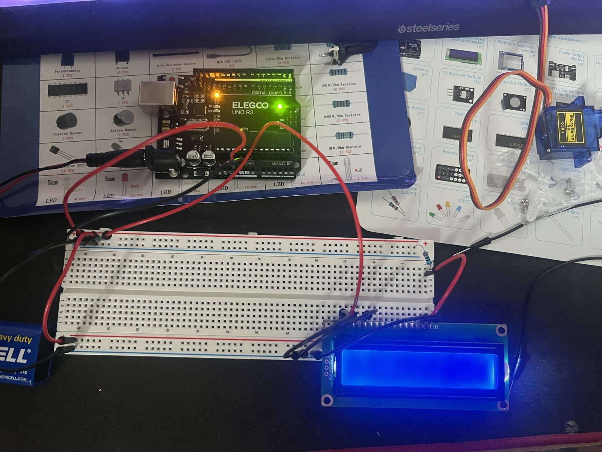
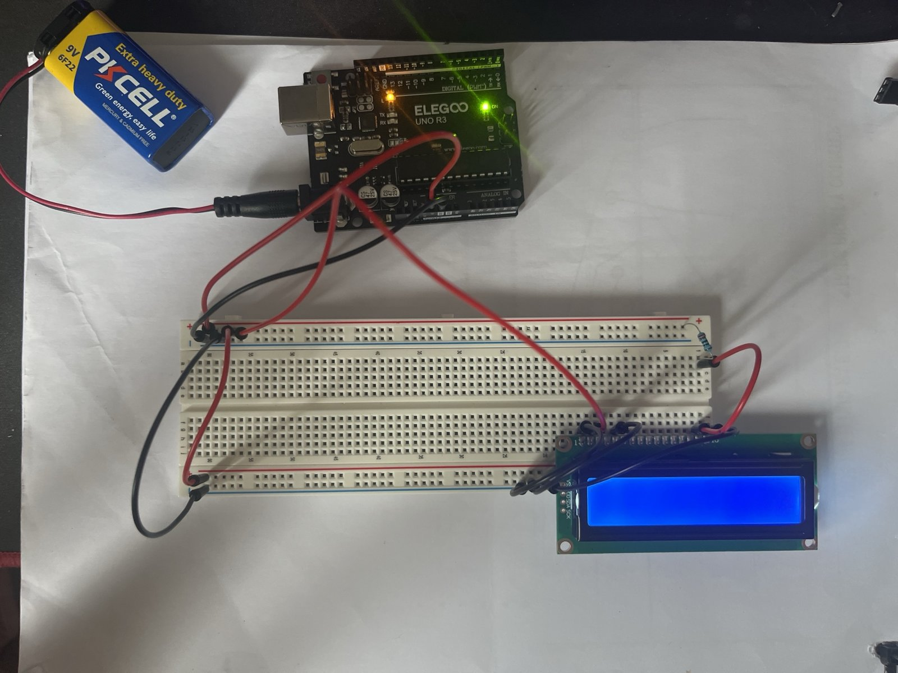
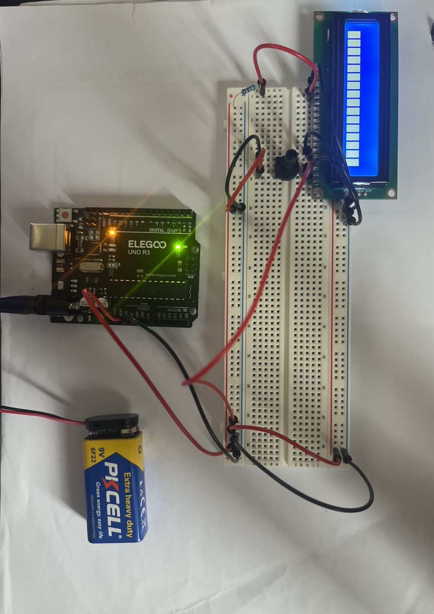
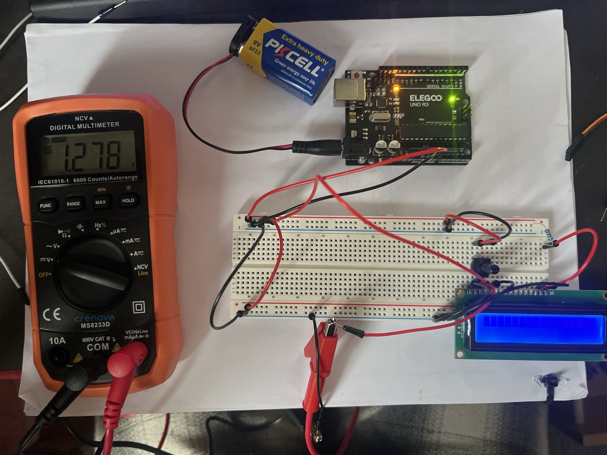
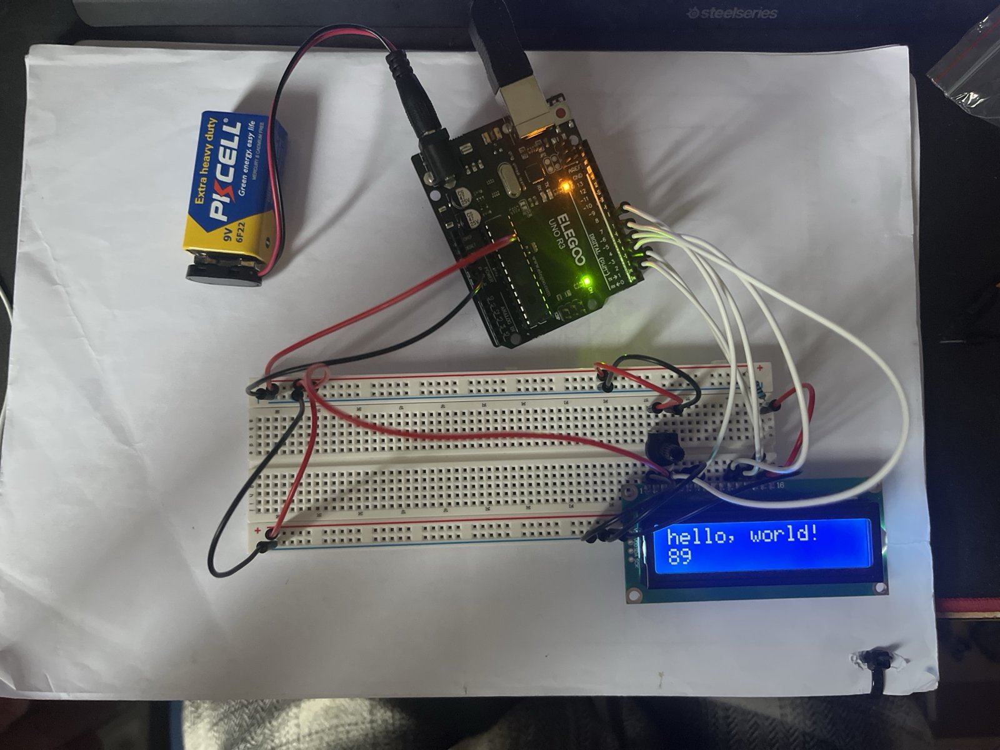
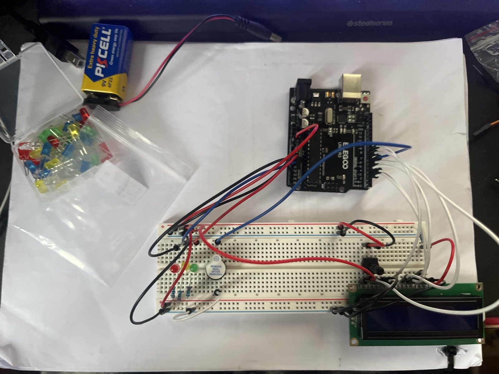
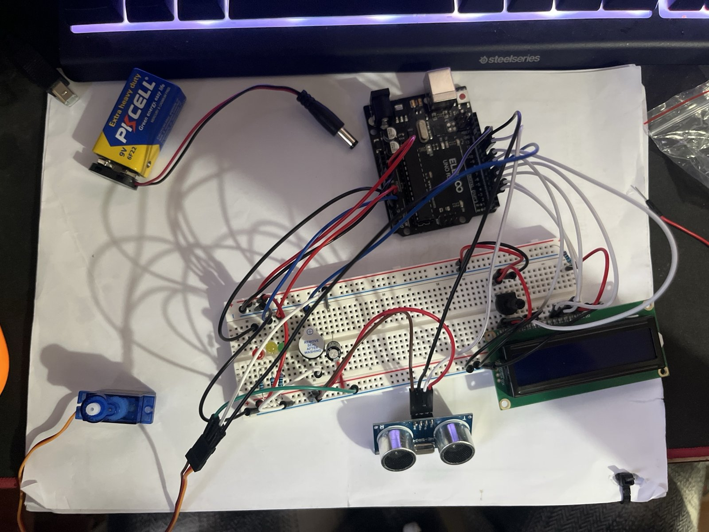

# Build journey

How the radar went from a parts list to a working build, in order — including the mistakes.
The finished design (firmware, schematic, calculations) is in [`final/`](../final/).

| File | What's in it |
|---|---|
| [engineering-log.md](engineering-log.md) | Day-by-day record: decisions, measurements, what went wrong |
| [problems-and-fixes.md](problems-and-fixes.md) | Every fault I hit: what I saw → cause → how I found it → fix |
| [photos](photos/) | Photos in build order |

## Timeline in photos

### 1. First wiring attempt

Getting the Uno, breadboard and LCD laid out for the first time, with the backlight powered.

### 2. Power rails and LCD backlight 

9 V battery into the Uno's barrel jack; the breadboard rails are fed from the Uno's 5V and
GND pins, so the LCD only ever sees 5 V. Before this, one + rail on my first breadboard was
damaged and I swapped boards — see [problems-and-fixes.md](problems-and-fixes.md).

### 3. Contrast pot fitted

With the 10 kΩ pot on V0 and no code running, the top line shows solid blocks: the LCD is
powered and the contrast works, but it hasn't been initialised yet.

### 4. Measuring the contrast voltage 

V0 = **1.278 V**, against the datasheet's ≈ 1.2 V (VDD − V0 = 3.8 V). That's about 2 % from
the recommended setting.

### 5. LCD wiring test passed 

Six signal wires to the Uno and the IDE's HelloWorld example uploaded: text on line 1, a
seconds counter on line 2. The blocks from step 3 disappear once `lcd.begin()` runs.

### 6. LEDs and buzzer wired

Red, yellow and green LEDs, each with a 220 Ω resistor, plus the active buzzer, added to the
breadboard and wired to the Uno. Taken before powering up (the LCD is dark because the board
is unplugged), so this stage isn't tested yet.

### 7. Full circuit wired

Every part is now on the board: the HC-SR04 sensor and SG90 servo on jumper leads, and the
100 µF capacitor for the servo supply, alongside the LCD, LEDs and buzzer. Taken unpowered,
before the first full test. The sensor isn't mounted on the servo horn yet.

### 8. Working radar 

First full run worked. The sensor is taped to the servo horn, and the LCD reads
"Angle: 90°, Dist: 20 cm" — right on the yellow/red boundary, with the yellow LED lit.

